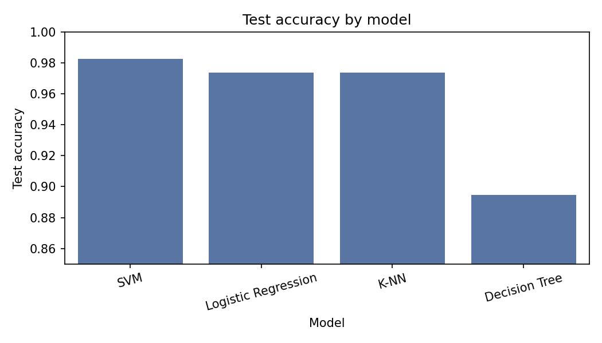
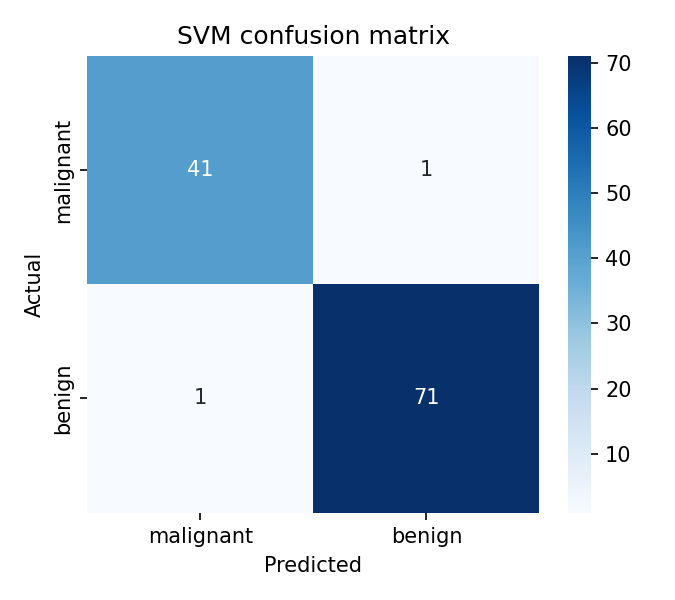

# Breast Cancer Classification

Machine learning models that classify breast tumors as **malignant** or **benign** from cell-nucleus measurements, with two complementary analyses and an interactive dashboard.


## Problem
Early and accurate diagnosis matters in breast cancer care. This project builds and compares classifiers that predict whether a tumor is malignant or benign from features of a fine needle aspirate image.

## Dataset
Breast Cancer Wisconsin (Diagnostic), from the UCI Machine Learning Repository, loaded with `sklearn.datasets.load_breast_cancer` (no download needed). 569 samples (212 malignant, 357 benign), 30 numeric features computed from cell-nucleus images. No original medical images are included.

## Approach
Both analyses use a stratified 80/20 split with a fixed random seed and scale features inside a pipeline.

1. **Tuned model comparison** (`src/classify_gridsearch.py`): Logistic Regression, Decision Tree, SVM and K-NN, each tuned with `GridSearchCV` (5-fold stratified CV), then evaluated on the held-out test set with accuracy, precision, recall, F1 and a confusion matrix.
2. **Interactive dashboard** (`src/dashboard.py`, `src/render_dashboard.py`): compares Logistic Regression, SVM and Random Forest, picking the model by malignant-class recall, then F1. Output is an interactive HTML dashboard.

## Results
Tuned comparison, test set of 114 samples (benign is the positive class):

| Model | CV accuracy | Test accuracy | Precision | Recall | F1 |
|---|---|---|---|---|---|
| **SVM** | 0.9758 | **0.9825** | 0.9861 | 0.9861 | 0.9861 |
| Logistic Regression | 0.9824 | 0.9737 | 0.9726 | 0.9861 | 0.9793 |
| K-NN | 0.9648 | 0.9737 | 0.9600 | 1.0000 | 0.9796 |
| Decision Tree | 0.9319 | 0.8947 | 0.9688 | 0.8611 | 0.9118 |

The dashboard comparison reports SVM and Logistic Regression both at 98.2% accuracy and Random Forest at 94.7% (`outputs/model_comparison.csv`, `outputs/metrics.json`). With a 114-sample test set, a difference of one or two predictions separates the top models, so treat the ranking as indicative.




## Project contents
- `src/classify_gridsearch.py`: GridSearchCV comparison. Writes `outputs/gridsearch_comparison.csv`, `gridsearch_best_params.json`, `gridsearch_accuracy.png`, `svm_confusion_matrix.png`.
- `src/dashboard.py`, `src/render_dashboard.py`: dashboard data, HTML (`outputs/dashboard.html`) and preview image (`outputs/dashboard.png`).
- `index.html`: opens the interactive dashboard.

## Run it
```bash
python -m pip install -r requirements.txt
python src/classify_gridsearch.py
python src/dashboard.py
python src/render_dashboard.py
```

## Disclaimer
Results are for learning and comparison only. This is not a clinical diagnostic tool and should not be used for patient-care decisions.

## Data source
- Scikit-learn loader: https://scikit-learn.org/stable/modules/generated/sklearn.datasets.load_breast_cancer.html
- UCI Machine Learning Repository, Breast Cancer Wisconsin (Diagnostic): https://archive.ics.uci.edu/dataset/17/breast+cancer+wisconsin+diagnostic
