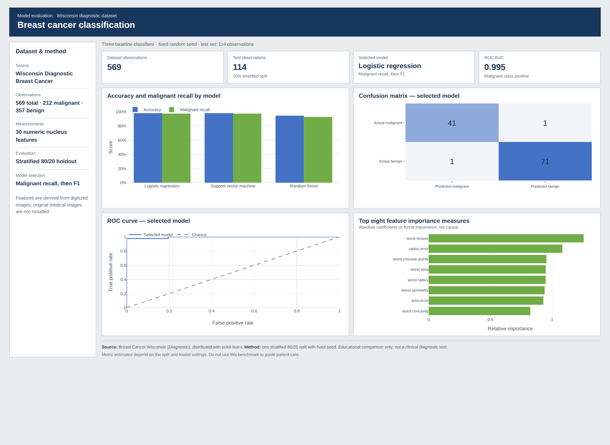

# Breast Cancer Classification

A small model-comparison project using the Breast Cancer Wisconsin (Diagnostic) dataset that comes with scikit-learn. It compares logistic regression, a support vector machine and a random forest on one stratified holdout split.



## What is in the project

- `src/dashboard.py` — loads the benchmark, trains the models, calculates test-set metrics and writes the dashboard data and HTML.
- `outputs/dashboard.html` — interactive model evaluation dashboard.
- `outputs/dashboard.png` — static preview image.
- `outputs/model_comparison.csv` — test-set scores.

## Run it

```bash
python -m pip install -r requirements.txt
python src/dashboard.py
python src/render_dashboard.py
```

The dataset contains 569 observations and 30 numerical features computed from cell-nucleus images. The dataset is provided with scikit-learn and is based on the Wisconsin Diagnostic Breast Cancer dataset. No original medical images are included.

The evaluation uses a stratified 80/20 split with a fixed random seed. The selected model is chosen by malignant-class recall, then F1-score. Results are for learning and comparison only; this is not a clinical diagnostic tool and should not be used for patient-care decisions.

## Data source

Scikit-learn dataset loader: https://scikit-learn.org/stable/modules/generated/sklearn.datasets.load_breast_cancer.html

Original data reference: UCI Machine Learning Repository, Breast Cancer Wisconsin (Diagnostic): https://archive.ics.uci.edu/dataset/17/breast+cancer+wisconsin+diagnostic
